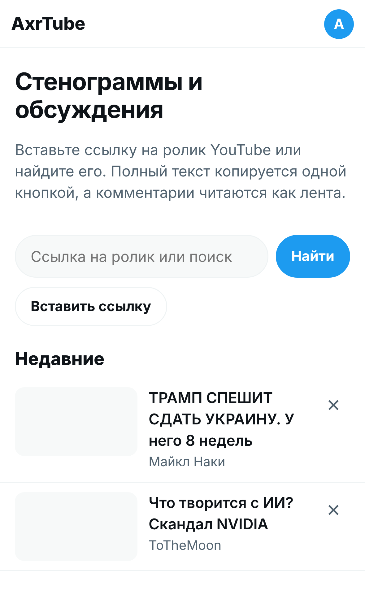
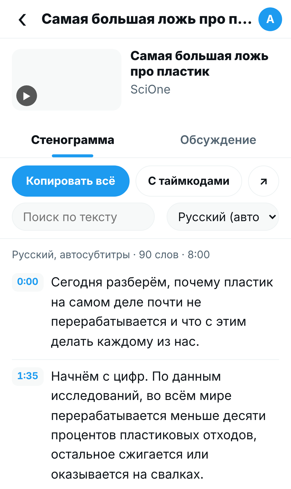
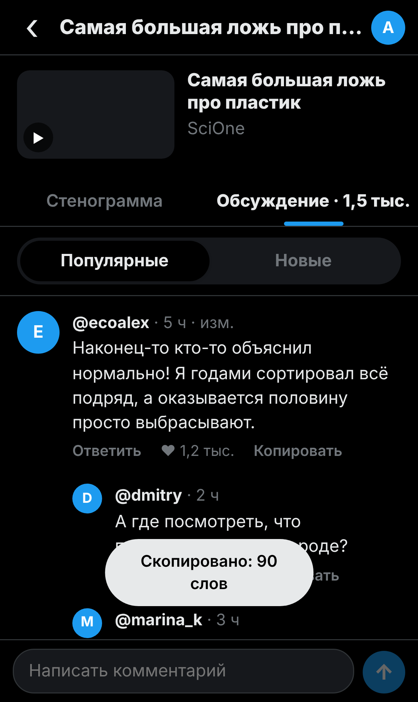
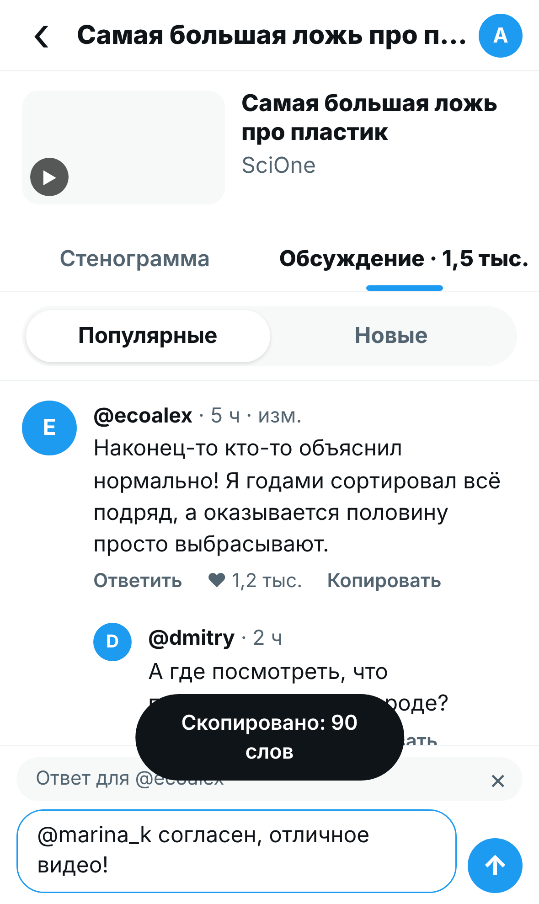

# AxrTube: охотник за стенограммами

Мобильное веб-приложение (PWA), которое делает с роликами YouTube две вещи:

1. **Достаёт полную стенограмму** и копирует её в буфер одной кнопкой.
2. **Превращает комментарии в нормальную ленту**, которую удобно читать и в которой удобно отвечать, примерно как в Twitter.

Видео приложение не показывает. Только текст и люди.

**Открыть:** https://axrtube.axrbarsic.workers.dev

| Главная | Стенограмма | Обсуждение | Ответ |
| --- | --- | --- | --- |
|  |  |  |  |

*Скриншоты сделаны на демо-данных.*

> **Статус:** ранняя версия. Стенограммы и интерфейс проверены автотестами и в браузере с размером iPhone. Публикация комментариев с реального аккаунта ещё проходит проверку.

## Возможности

**Стенограмма**
- Вставьте ссылку или найдите ролик поиском. Подходят обычные ссылки, `youtu.be`, Shorts, трансляции и «Поделиться» из приложения YouTube.
- «Копировать всё»: название, канал, ссылка и весь текст абзацами.
- «С таймкодами»: тот же текст с отметками времени.
- Поиск по тексту с подсветкой совпадений.
- Выбор языка, если у ролика несколько дорожек субтитров.
- Нажатие на время копирует ссылку на этот момент ролика.

**Обсуждение**
- Лента комментариев с переключателем «Популярные / Новые».
- Ветки ответов раскрываются прямо в ленте.
- Длинные комментарии сворачиваются, кнопка «Ещё» разворачивает.
- Поле ввода внизу экрана, «Ответить» под любым комментарием.
- Свой комментарий появляется в ленте сразу после отправки.
- Комментарии читаются и пишутся от вашего имени через вход в Google.

**Остальное**
- Светлая и тёмная тема по настройке телефона.
- Недавние ролики хранятся только на вашем устройстве.
- Android: AxrTube появляется в меню «Поделиться» приложения YouTube.

## Как установить на телефон

**iPhone:** откройте ссылку в Safari → «Поделиться» → «На экран „Домой“».
**Android:** откройте ссылку в Chrome → меню → «Установить приложение».

## Как это устроено

Приложение работает как один [Cloudflare Worker](https://developers.cloudflare.com/workers/) без внешних зависимостей: сервер и интерфейс собираются в один файл.

| Часть | Файл | Что делает |
| --- | --- | --- |
| Маршруты и заголовки безопасности | `worker/index.js` | Страница, статика, API, CSP |
| Стенограммы | `worker/transcript.js` | Субтитры YouTube, абзацы, запасной источник |
| Комментарии | `worker/comments.js` | YouTube Data API v3: чтение, ответы, публикация |
| Вход через Google | `worker/youtube-account.js` | OAuth с PKCE, зашифрованные HttpOnly cookies |
| Поиск | `worker/catalog.js` | Поиск YouTube без рекламных карточек |
| Интерфейс | `worker/app-client.js`, `worker/app-shell.js` | Экраны, стили, манифест, Service Worker |

**Откуда берётся стенограмма.** Сервер получает список дорожек субтитров, в первую очередь так, как их видят мобильные приложения YouTube: их ссылки на субтитры не требуют проверки браузера. Текст очищается от повторов автосубтитров и собирается в абзацы. Если YouTube отклонит запрос, используется панель «Показать расшифровку» со страницы ролика.

**Откуда берутся комментарии.** Через официальный [YouTube Data API v3](https://developers.google.com/youtube/v3/docs/commentThreads) с токеном вошедшего пользователя. Для публикации нужно разрешение `youtube.force-ssl`. Лимит API по умолчанию: 10 000 единиц в день. Чтение страницы комментариев стоит 1 единицу, публикация 50.

## Безопасность и приватность

- Токены Google хранятся только в зашифрованных cookies с флагами `HttpOnly`, `Secure` и `SameSite`. Ключ шифрования есть только у сервера.
- Вход защищён PKCE и проверкой `state`. Публикация комментариев принимается только с того же адреса (проверка `Origin`).
- Строгая CSP: никаких сторонних скриптов и встроенного JavaScript. Весь текст из YouTube выводится как текст, а не как HTML.
- Сервер не хранит ни стенограммы, ни комментарии, ни историю. Недавние ролики лежат только в `localStorage` телефона.

## Разработка

Нужен Node.js 20 или новее. Сторонних npm-пакетов нет.

```sh
npm run build      # собрать dist/server/index.js
npm run validate   # проверить, что сборка экспортирует fetch
npm test           # все тесты
```

## Своя копия

1. Создайте Worker в Cloudflare и Web OAuth-клиент в Google Cloud с адресом возврата `https://<ваш-адрес>/oauth/google/callback`.
2. Замените `accountOrigin` в `worker/youtube-account.js` на свой адрес.
3. Задайте в Cloudflare секреты `GOOGLE_OAUTH_CLIENT_SECRET` и `GOOGLE_OAUTH_COOKIE_KEY` (64 символа hex, например `openssl rand -hex 32`).
4. Скопируйте `.env.example` в `.env`, заполните и выполните:

```sh
npm run build && set -a && . ./.env && set +a && npm run deploy
```

## Ограничения

- YouTube периодически ограничивает запросы с адресов дата-центров. Для субтитров это встречается реже, чем для видео, но гарантии нет.
- Комментарии доступны только после входа через Google.
- Ставить лайки комментариям официальный API не позволяет.
- У ролика без субтитров стенограммы нет.
- Это неофициальный проект, он не связан с YouTube и Google.

## Лицензия

[GPL-3.0](LICENSE)
